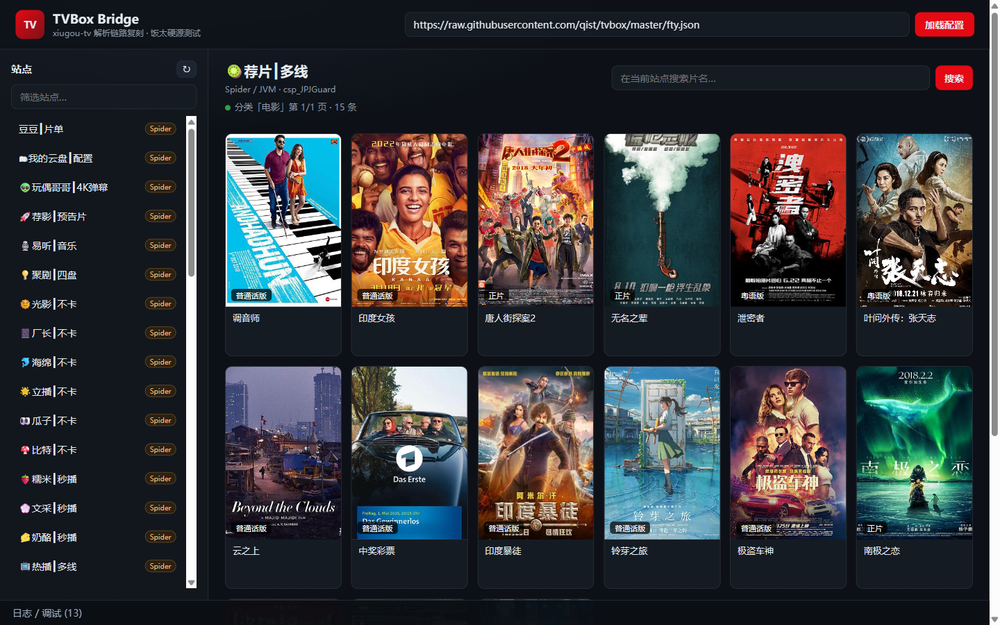
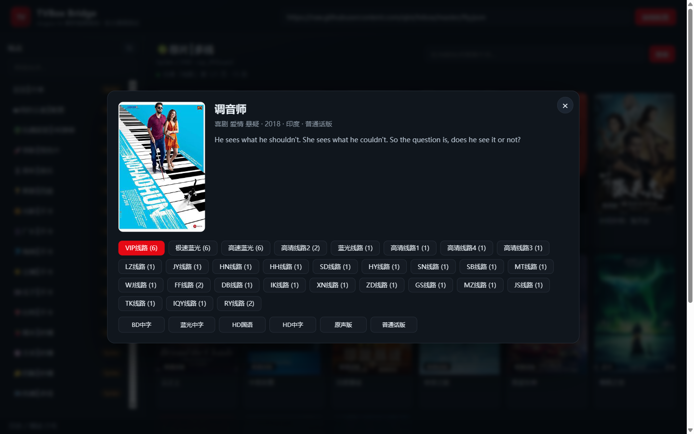
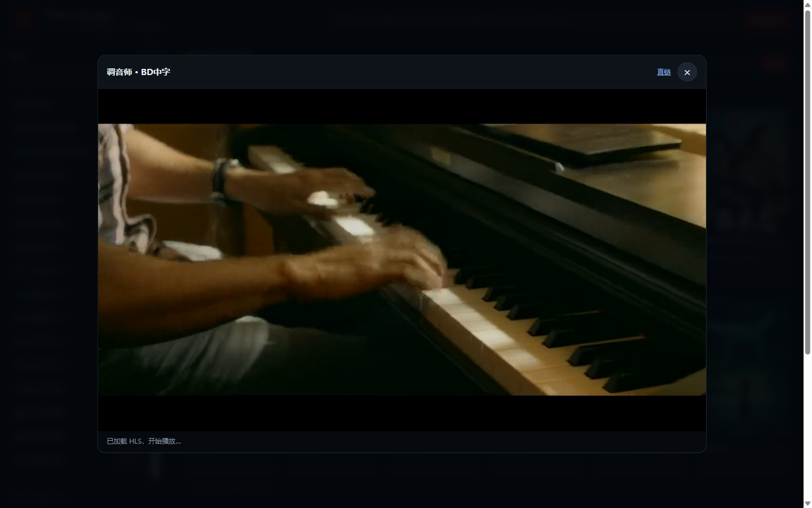

# tvbox-bridge

TVBox / CatVod 解析链路的简易 Web 复刻，用于验证 **饭太硬** 等影视配置是否可用。

后端复用了 [xiugou-tv](../xiugou-tv) 的 Java 解析层（CatVod spider 契约 + Android 运行时 shim + 加固载荷解密 + dex2jar），前端是一个纯浏览器页面，支持分类浏览、搜索、详情、选集与 HLS/mp4 播放。

> 仅供本机技术验证。软件不提供内容源，播放内容来自你自行添加的配置。服务只监听 `127.0.0.1`。

---

## 1. xiugou-tv 的实现方式（分析）

### 1.1 分层

```
Flutter UI
  └─ SiteApi（统一站点调度）
       ├─ CmsJsonApi      type 0/1：直连 CMS（XML / JSON）
       └─ CompanionSpiderApi
            └─ 本地 Java 伴随进程（companion-service.jar）
                 └─ SpiderServer（HTTP RPC）
                      └─ DexSpiderLoader（jar/加固载荷/dex2jar/ClassLoader）
                           └─ CatVod Spider 实现（csp_* / .js）
```

### 1.2 配置加载（`lib/core/config/`）

- `ConfigRepository` 支持远程 URL、本地文件、粘贴文本；多仓 `{"urls":[{"name","url"}]}` 递归解析（最多 8 层）。
- `ConfigDecoder` 依次尝试：`<pre>` 内嵌 → 严格 JSON → `XXXXXXXX**<Base64>` 标记 → 宽松 JSON（注释、无引号键、尾逗号）→ 整体 Base64。
- 站点中的相对 `api` / `ext` / `jar` 与全局 `spider` 按配置地址还原为绝对地址（`RelativeUrl`），`jar` 的 `;md5;...` 会保留并校验。
- 数据模型：`Site`（`type` 0=XML CMS、1=JSON CMS、3=Spider；`csp_`、`.js`、`.py` 也视为 Spider）、`Parse`、`Live`、`FlagRule`。

### 1.3 站点执行

| 站点类型 | 执行方式 | 关键参数 |
|---|---|---|
| type 0 XML CMS | `CmsJsonApi` 直接 HTTP | `ac=videolist&t=&pg=`、`wd=`、`ids=` |
| type 1 JSON CMS | `CmsJsonApi` 直接 HTTP | `ac=detail&t=&pg=`、`wd=`、`ids=` |
| type 3 / `csp_` / `.js` | Java companion | CatVod spider RPC |
| `.py` | 需要 Python 运行时，桌面端不支持 | — |

CMS 请求带多级兜底（无参数 → `ac=videolist` → `ac=detail` → 纯 `t/pg`），JSON 与 XML 双解析；`ext` 为 http(s) 时作为备用 endpoint，否则作为 `extend` 参数。

### 1.4 Java 伴随进程（`companion/` + `android-bridge/`）

- `Main` 启动 `AndroidBridge.serve(0)`，打印 `[COMPANION_READY] PORT=<n>` 供 Flutter 解析；`--stdin-watch` / `--parent-pid` 防止孤儿进程。
- `SpiderServer` 暴露：
  - `POST /spider/load`：`{key, api, ext, jar}` → 实例化并 `init`
  - `POST /spider/call`：`{siteKey, api, ext, jar, method, ...}`，method 为 `homeContent / homeVideoContent / categoryContent / detailContent / searchContent / playerContent / liveContent`
  - `GET /health`、`POST /shutdown`
  - 默认 60s 看门狗、最多 64 个并发调用；超时返回 504，异常返回 500（`error/stage/detail`）。
- `DexSpiderLoader` 是解析核心：
  - `csp_XxxGuard` 先去 Guard 后缀，从载荷 jar 找 `com.github.catvod.spider.Xxx`；
  - 下载 jar、校验 `;md5;`，识别加固壳（`assets/*.guard`），首次用 unidbg 子进程解密（约 9s），按壳 md5 缓存；
  - Android 容器（仅 `classes.dex`）用 dex2jar 转 JVM jar，并做字节码修补（`Dex2jarRepair`）；
  - 注入 `Init` / `InitOrigin`、`GuardHost`（加固壳的 encrypt/decrypt/md5/calcResult Java 近似实现）、Android shim；
  - `GuardProxyServer` 起本地代理，并把载荷返回的 `127.0.0.1:9978/proxy?...` 改写成 `/proxy/<base64url>`；
  - `FyGuard` 等会让 JVM 段错误的载荷被 `BLOCKED_API` 拒绝，避免拖死整个进程。

### 1.5 播放解析（`SiteApi.resolvePlayback` / `ParseEngine`）

- Spider：`playerContent(flag, id)` 返回 `{url, parse, jx, header, playUrl}`。
  - `parse==0 && jx==0`：`url` 即媒体地址；
  - `parse==1 || jx==1`：用配置 `parses` 里的 JSON 接口（`type=1`，`GET parseUrl + 原始地址`）提取 `url` / `data.url`；
  - `playUrl`（网页解析前缀）当前不支持；
  - 请求头按 site → spider → parser 顺序合并（大小写不敏感）。
- CMS：选集 URL 本身是播放地址；若是 `.m3u8/.mp4` 直接播放，否则尝试 JSON 解析接口。

---

## 2. 本项目做了什么

```
server.js                     Node 后端：配置解码、CMS/Spider 调度、媒体代理、HLS 重写、鉴权
public/                       前端：站点列表、分类、海报墙、详情、选集、hls.js 播放器
companion-build/build.sh      从 xiugou-tv 源码构建 companion-service.jar（JDK 17+）
companion-build/overlay/      两个必要 shim 补丁（见下）
scripts/test-fty.js           饭太硬源可用性自动测试
docs/API.md                   第三方接口文档
docs/openapi.yaml             OpenAPI 3.0 规范
Dockerfile / docker-compose.yml
.github/workflows/docker.yml  构建镜像 → 冒烟测试 → 推送 GHCR
```

要点：

1. **原样复用 Java 解析层**：直接编译 `xiugou-tv/android-bridge` + `xiugou-tv/companion/src`，打包成自包含 jar，运行时 `java -jar companion-service.jar --port=0`，由 Node 解析握手行并调用 RPC。
2. **补齐两个 Android shim**（原仓库缺少，饭太硬载荷会因此失败）：
   - `android.graphics.drawable.Drawable$ConstantState`：`ProxyOrigin` 在 `playerContent` 路径调用 `getConstantState().newDrawable()`，缺失会抛 `NoClassDefFoundError`，表现为「站点暂不可用 (stage=call)」。
   - `android.widget.ListAdapter`：`Pan` 初始化时引用。
3. **直接解包本地代理 URL**：spider 返回的 `127.0.0.1:9978/proxy?do=m3u8&url=...` 或 `/proxy/<base64url>` 在 Web 端没有对应服务，后端会取出内层真实地址。
4. **媒体代理**：`/api/stream` 负责透传 UA/Referer/Origin、Range；遇到 m3u8 会重写每个分片、子清单、`EXT-X-KEY` / `EXT-X-MAP` 的 URI，使 hls.js 能通过本地代理加载（含 AES-128 密钥）。
5. **图片代理**：`/api/img` 解决海报防盗链。
6. **代理策略**：配置/载荷（GitHub）走 `HTTPS_PROXY` 优先；媒体/CMS/解析走直连优先，失败再走代理；避免国内站点被代理 TLS 拒绝（如 `mv.gzlcl.com`）。
7. **JDK 17 可运行**：xiugou-tv 发布基线是 JDK 21，但依赖字节码是 61（Java 17），仅有的 Java 21 `module-info.class` 在打包时删除后即可用 17 运行。
8. **数据目录改名**：构建时把上游写死的运行时目录名替换为 `.tvbox_bridge`（载荷缓存 / prefs / sdcard），镜像与用户目录里不会出现上游品牌目录。
9. **一步解析 + 鉴权**：`/api/resolve` 输入片名直接返回可播放地址；`BRIDGE_TOKEN(S)` 开启后所有接口需 token，代理出的 `stream` 自动带上调用方 token。

### API 一览

| 方法 | 路径 | 说明 |
|---|---|---|
| GET | `/api/health` | 健康检查（公开） |
| GET | `/api/status` | companion / 已加载站点状态 |
| POST | `/api/config` | `{url}` 加载配置/多仓 |
| GET | `/api/sites` | 当前站点列表 |
| POST | `/api/site/load` | `{key}` 预热 Spider |
| POST | `/api/home` | `{key, filter}` |
| POST | `/api/category` | `{key, tid, pg, filter}` |
| POST | `/api/search` | `{key, wd, quick, pg}` |
| POST | `/api/detail` | `{key, id}` |
| POST | `/api/play` | `{key, flag, id}` → `{url, headers, needsParse, stream}` |
| POST/GET | `/api/resolve` ⭐ | `{site, name}` → 一步解析出可播放地址 |
| GET | `/api/stream?u=&h=&t=` | 媒体代理（HLS 重写） |
| GET | `/api/img?u=&r=&t=` | 图片代理 |
| GET | `/api/logs` | companion 日志 |

完整参数、响应示例与错误码见 **[docs/API.md](docs/API.md)**，机器可读规范见 **[docs/openapi.yaml](docs/openapi.yaml)**。

---

## 3. 运行

### 3.1 Docker（推荐）

镜像里已带 JRE 17，一条命令即可：

```bash
docker run -d --name tvbox-bridge -p 8787:8787 \
  -e BRIDGE_TOKEN=your-secret-token \
  -v tvbox-data:/data \
  ghcr.io/<owner>/tvbox-bridge:latest
```

或使用 compose（记得先改 token）：

```bash
docker compose up -d
```

| 环境变量 | 默认 | 说明 |
|---|---|---|
| `BRIDGE_TOKEN` | — | 接口鉴权 token；不设则开放访问 |
| `BRIDGE_TOKENS` | — | 多个 token，逗号分隔（优先于 `BRIDGE_TOKEN`） |
| `PORT` | `8787` | 监听端口 |
| `HOST` | `0.0.0.0`（镜像）/ `127.0.0.1`（源码） | 监听地址 |
| `PUBLIC_BASE_URL` | — | 反向代理/公网地址，用于生成绝对 `streamUrl` |
| `HTTPS_PROXY` / `HTTP_PROXY` | — | 拉取 GitHub 配置与 spider 载荷用 |
| `JAR_CACHE_DIR` | `/data/jars` | 预下载 spider jar 的缓存目录 |
| `COMPANION_HOME` | `/data` | companion 用户目录（`<home>/.tvbox_bridge`） |

`/data` 是持久卷：首次解密载荷约 30s，缓存后数秒；不挂载则每次重建容器都要重新解密。

### 3.2 源码运行

前置：Node.js 18+（实测 22）、JDK 17+、本机可访问 GitHub（或配置代理）。

```bash
npm install
npm run build:companion     # 编译 36MB 自包含 companion-service.jar
npm start                   # http://127.0.0.1:8787
```

打开页面 → 右上角填 Token（若开启鉴权）→「加载配置」→ 左侧选择站点（推荐先试 **荐片 / 光影 / 厂长**）→ 点海报看详情 → 点选集播放。

首次访问 Spider 站点需要：下载加固壳 → unidbg 解密（约 9s）→ dex2jar（约 19s）→ 类加载，总耗时约 70s；之后同一载荷的站点只需数秒。缓存目录为 `~/.tvbox_bridge/jars`。

代理（可选）：设置 `HTTPS_PROXY` / `HTTP_PROXY` 后，配置与 jar 下载优先走代理，媒体直连失败会自动回退代理。

自动测试（服务端开启鉴权时带上 `BRIDGE_TOKEN`）：

```bash
BRIDGE_TOKEN=your-secret-token npm run test:fty
node scripts/test-fty.js --sites 荐片,光影,厂长
```

### 3.3 CI 构建镜像

`.github/workflows/docker.yml`：

1. `companion` job：checkout 本仓库 + `xiugou-tv`（可用仓库变量 `COMPANION_REPO` 指向自己的 fork，`COMPANION_REPO_TOKEN` 提供私有仓库权限）→ JDK 17 → `companion-build/build.sh` → 上传 `companion/dist` 产物。
2. `docker` job：下载产物 → Buildx 构建（`linux/amd64`）→ **冒烟测试**（起容器、等 `/api/health`、校验无 token 401 / 带 token 200 级通过鉴权 / 查询参数鉴权）→ 推送 `ghcr.io/<owner>/<repo>`。

推送标签：分支名、`sha-<hash>`、`v1.2.3` 与 `v1.2`（tag 触发）、默认分支的 `latest`。PR 只构建不推送。

### 界面







---

## 4. 饭太硬源实测（2026-10-27）

### 4.1 地址现状

- 官方 `http://饭太硬.top/tv`、`http://www.饭太硬.cc/tv` 当前返回域名停放/占位图片，不是 JSON。
- 导航站 `https://www.xn--sss604efuw.net` 仍可访问，但其列出的 `/tv` 接口同样不可用。
- 因此测试使用社区镜像 **`https://raw.githubusercontent.com/qist/tvbox/master/fty.json`**（README 标注为「完全来源于饭太硬的 jar 包和配置」）。

配置画像：**49 个站点，全部 `type: 3` / `csp_*Guard`，0 条解析，6 个直播源**；spider 为 `./jar/fan.txt;md5;b55978c4fe6d12e2fea9075f17c8a67a`（约 1.4MB 加固壳）。

### 4.2 结论

| 站点 | 数据（首页/详情） | 播放 | 说明 |
|---|---|---|---|
| 荐片 | ✅ | ✅ | HLS + AES-128，浏览器实测播放成功（duration 8240s，`readyState=4`） |
| 光影 | ✅ | ✅ | master/variant m3u8 + TS 分片均 200 |
| 厂长 | ✅ | ✅ | m3u8 可播；部分剧集的 mp4 CDN 会返回 401 `Authorization sign not match`（源侧防盗链） |
| 瓜子 | ⚠️ | 曾成功 | 首次可用；随后首页/分类/搜索均空（源侧不稳定）。标题存在 UTF-8 被按 GBK 解码的乱码 |
| 热播 | ✅ | ❌ | m3u8 正常，但分片是 kwimgs 的占位 `.png`，返回 `NoSuchKey 404` |
| 立播 | ✅ | ❌ | m3u8 被 Cloudflare 403 / 超时（与出口 IP 有关） |
| 海绵 | ✅ | ❌ | `playerContent` 不返回 url |
| 风云 | — | — | xiugou-tv 主动屏蔽（`FyGuard` 会让 JVM 段错误） |

本次自动测试（7 个视频站）结果：**3/7 可完整播放**（光影、荐片、厂长）。其余失败原因均为上游源/防盗链/风控，而非解析链路本身。

另外验证了 CMS 分支：用 `qist/tvbox/0821.json`（饭太硬基础 + 若干 CMS 源）测试百度、量子、非凡，首页、分类、详情、播放地址均正常，证明 type 0/1 直连路径可用。

### 4.3 已知限制

- 仅支持 JSON 解析接口；网页嗅探（`playUrl`）与 Python 源不支持。
- 网盘类站点（夸克/阿里/UC 等）需要各自登录授权，未测试。
- JS 源依赖 companion 内置 GraalJS；饭太硬当前配置未使用。
- 部分载荷仍可能引用未实现的 Android API；本项目只补了实测阻断播放的两个 shim。
- 部分源存在 GBK 乱码，属于上游爬虫的编码处理问题，本项目未做猜测性转码。

---

## 5. 参考

- xiugou-tv：`../xiugou-tv`（GPL-3.0）
- 上游产品形态：FongMi/TV、TVBox、CatVod
- 配置镜像：qist/tvbox（饭太硬衍生配置）